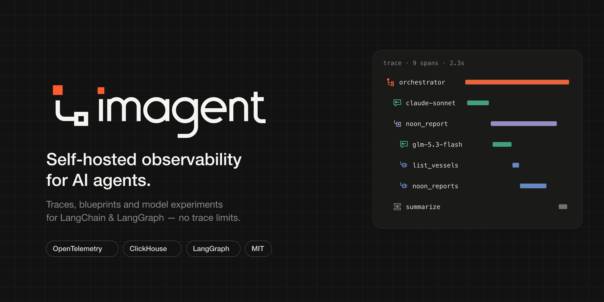
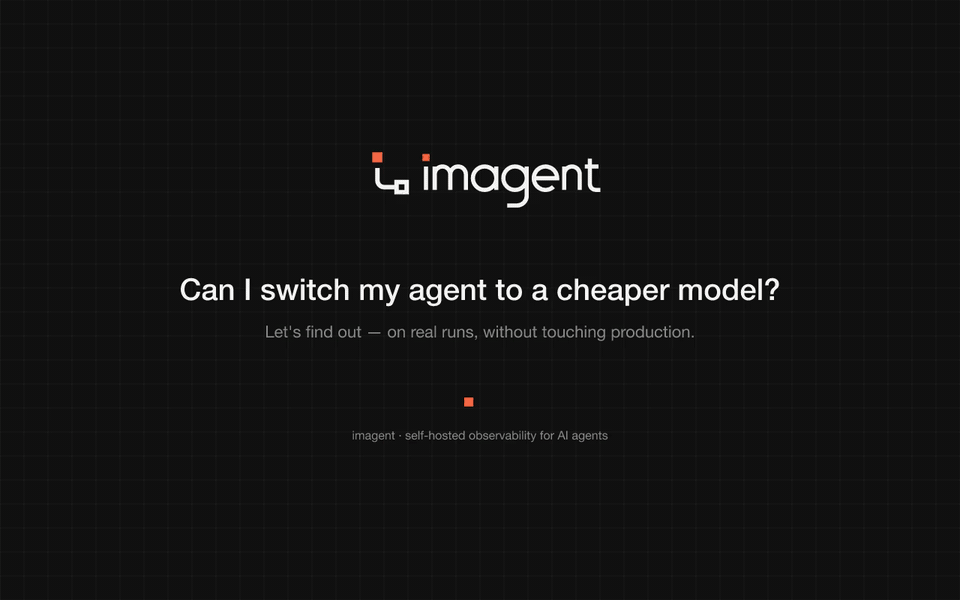
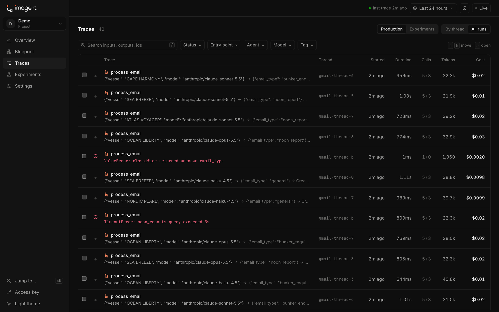
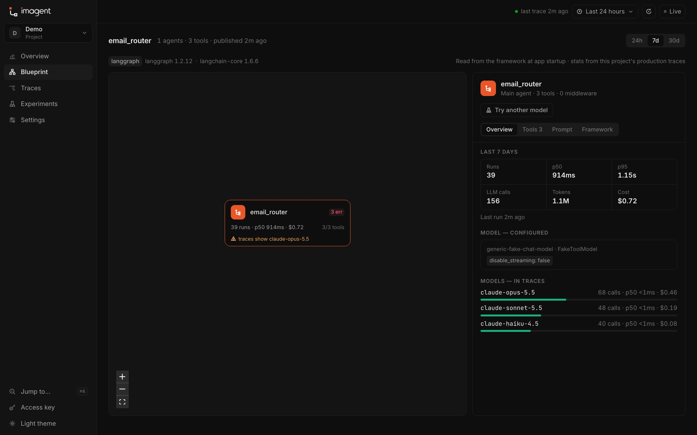
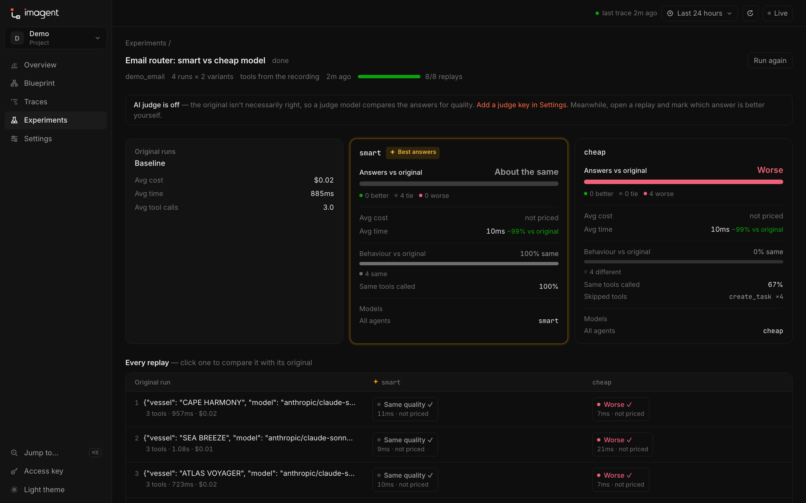
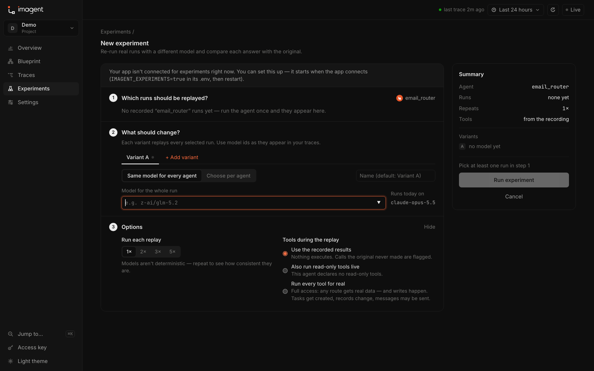
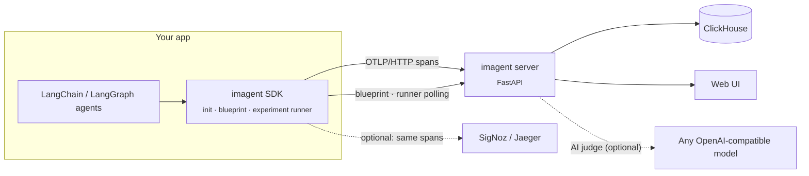

<p align="center">
  
</p>

<p align="center">
  <a href="LICENSE"></a>
  
  
  
  
  <a href="https://github.com/Mathankarthik18/imagent/stargazers"></a>
</p>

<p align="center">
  <a href="#-quick-start"><b>Quick start</b></a> ·
  <a href="#-features"><b>Features</b></a> ·
  <a href="#-experiments">Experiments</a> ·
  <a href="#-how-it-works">How it works</a> ·
  <a href="#-configuration">Configuration</a> ·
  <a href="#-roadmap">Roadmap</a>
</p>

---

**imagent** is an open-source, self-hosted alternative to hosted LLM tracing tools. Point your
LangChain / LangGraph app at it with **one line of code** and get every agent run as a trace,
your app's structure as a live **blueprint**, and **experiments** that replay real runs with
another model — judged for answer quality, not just "did it behave the same".

- **No limits, no seats.** Your traces live in your own ClickHouse; keep as many as your disk holds.
- **Built on OpenTelemetry.** GenAI semantic conventions in, nothing locked in — spans can go to SigNoz or Jaeger too.
- **Made for agents.** Sub-agents, tool calls, middleware and model swaps are first-class, not an afterthought.

### ▶ See it in action

> *"Can I switch my agent to a cheaper model?"* — trace a run, replay it, try the cheaper model on real runs, and see what changed. (68 s)

<p align="center">
  <a href="docs/assets/demo.mp4"></a>
  <br /><sub><a href="docs/assets/demo.mp4">Watch in full quality (MP4)</a></sub>
</p>

## ✦ Features

<table>
  <tr>
    <td width="50%" valign="top">
      <br />
      <b>Traces</b><br />
      Every LLM call, tool call and sub-agent as a tree, a flow canvas and a replayable timeline — with tokens, cost, latency, cache hits and errors.
    </td>
    <td width="50%" valign="top">
      <br />
      <b>Blueprint</b><br />
      Your agent app drawn from the framework itself: agents, sub-agents, models, prompts, tools and middleware — including parts that never ran — with live stats on top.
    </td>
  </tr>
  <tr>
    <td valign="top">
      <br />
      <b>Experiments</b><br />
      Replay real runs with another model — for the whole run or a single agent — with tools answered from the recording, so nothing real executes.
    </td>
    <td valign="top">
      <br />
      <b>AI judge</b><br />
      The original run isn't ground truth. A judge model compares both answers blind — correct against the tool data, complete, clear, your own rubric — and your review overrides it.
    </td>
  </tr>
  <tr>
    <td valign="top">
      <br />
      <b>Projects</b><br />
      One project per app, each with its own API key. An app's API and worker can report into the same project.
    </td>
    <td valign="top">
      <br />
      <b>Live & accurate</b><br />
      Runs show up while they're running, stalled runs are flagged, broken-off LangGraph runs are stitched back together, and cost is priced from a daily-synced catalog.
    </td>
  </tr>
</table>

## ⚡ Quick start

**1 · Run imagent** (ClickHouse + server + UI):

```bash
git clone https://github.com/Mathankarthik18/imagent.git
cd imagent && docker compose up -d        # → http://localhost:8300
```

**2 · Create a project** in the UI (**New project**) and copy its API key.

**3 · Connect your app** — install the SDK into your app's virtualenv, add the key, call `init()`:

```bash
pip install "imagent @ git+https://github.com/Mathankarthik18/imagent.git#subdirectory=sdk"
echo "IMAGENT_API_KEY=imk_…" >> .env      # + IMAGENT_ENDPOINT=… if imagent isn't on localhost:8300
```

```python
import imagent

imagent.init()   # every LangChain / LangGraph run is now traced into your project
```

That's it. Each agent's **blueprint** is published on its first run, and LangSmith (or anything
else you use) keeps working in parallel.

> **Try it without an app:** `cd sdk && pip install -e . && python ../examples/demo_agents.py --runs 40 --api-key imk_…`
> sends realistic multi-agent traces from fake models — zero LLM cost.

<details>
<summary><b>Optional extras</b></summary>

```python
with imagent.context(thread_id=conversation_id, user_id=user.id, tags=["email"]):
    await graph.ainvoke(...)          # group runs into conversations

@imagent.observe(kind="tool")
def lookup_vessel(imo: str): ...      # trace your own functions
```

</details>

## 🔍 Traces

<p align="center"></p>

Browse by conversation or by run, filter by status, agent, model and tag, and full-text search
inputs and outputs. Open a run to see it as a **flow canvas** (agents and sub-agents as frames),
a **steps tree** (optionally with framework plumbing), and a **replay** that plays the run back
in time with inputs and outputs streaming in. Pick two runs to **compare** them side by side.

## 🧭 Blueprint

<p align="center"></p>

`imagent.init()` reads each compiled agent the first time it runs — LangGraph nodes and edges,
deepagents sub-agents, every tool with its description, the middleware chain, the bound model and
the system prompt — and draws the app. Live numbers come from your traces: runs, p50/p95, cost,
tool usage, and which models *actually* ran (with a warning when that differs from the config).

## 🧪 Experiments

<p align="center"></p>

Changed a model to cut cost — did the agent get worse? Pick recorded runs, choose a model for the
whole run **or per agent on the blueprint**, and imagent re-runs your real agent inside your app:

```bash
# in your app's .env
IMAGENT_EXPERIMENTS=true
```

```python
# on the function that builds your agent — tells imagent how to rebuild it safely
@imagent.agent("orchestrator", replay_overrides={"context": {"db": None, "dry_run": True}})
def build_orchestrator(tools, profile="chat"):
    return create_deep_agent(...)
```

- **Same agent, same inputs.** The replay rebuilds the agent with the recorded run's own build arguments and config.
- **Tools, your choice.** *Recorded* (default — answered from the original run, nothing executes),
  *live reads*, or *fully live* (every tool runs for real; guarded by an explicit confirmation).
- **Never your database.** Checkpointer and store are swapped for in-memory ones; `replay_overrides` neutralise live context.
- **Scored twice.** *Behaviour* (same tools? similar answer?) and *answer quality* by the AI judge — so a different
  path that gives a better answer counts as better.

<p align="center"></p>

## 🏗 How it works



| Directory | What |
|---|---|
| [`sdk/`](sdk) | Python library `imagent`: tracing (`init`, `observe`, `context`), blueprints, the experiment runner, redaction |
| [`server/`](server) | FastAPI: OTLP ingest → ClickHouse, cost, read API, projects, experiments, AI judge; serves the UI |
| [`ui/`](ui) | React + Vite + Tailwind web app, with its own icon set and brand ([`design/brand`](design/brand)) |
| [`examples/`](examples) | Demo agents with fake models, and a demo experiment runner |

### What gets captured

Per span: kind (agent / sub-agent / LLM / tool / framework), parent links, timings, model and
provider, input / output / cache-read / cache-write tokens, cost (provider-reported, e.g. OpenRouter
`usage.cost`, otherwise computed), time to first token, prompts, completions, tool arguments and
results (redacted and truncated), errors with stack traces, and thread / user / session / agent /
tags / metadata. Attributes follow the **OTel GenAI conventions** (`gen_ai.*`), so imagent also
accepts spans from OpenLLMetry, OpenInference and vendor SDKs.

### Cost

1. **Provider-reported** — e.g. OpenRouter returns the billed cost per call.
2. **Computed** — tokens × price, from `IMAGENT_PRICING_FILE` overrides, built-in Anthropic prices,
   then a catalog synced daily from OpenRouter's public model list (no key, no trace data sent).
3. Calls still unpriced show as *not priced* and are re-priced automatically once a price appears.

## ⚙ Configuration

**Server** (`docker-compose.yml` / environment)

| Variable | Default | |
|---|---|---|
| `IMAGENT_INGEST_KEY` | — | Server-wide ingest key (project keys work without it) |
| `IMAGENT_READ_KEY` | — | Protects `/api/*`; the UI asks for it once |
| `IMAGENT_RETENTION_DAYS` | `30` | ClickHouse TTL for spans |
| `IMAGENT_JUDGE_API_KEY` | — | Server-wide fallback for the AI judge (projects can set their own in Settings) |
| `IMAGENT_JUDGE_MODEL` | `anthropic/claude-sonnet-5.5` | Judge model |
| `IMAGENT_JUDGE_BASE_URL` | OpenRouter | Any OpenAI-compatible endpoint |
| `IMAGENT_PRICE_SYNC` | `true` | Daily model-price sync |

**SDK** (environment or the app's `.env`)

| Variable | Default | |
|---|---|---|
| `IMAGENT_API_KEY` | — | Project key — decides which project the app reports into |
| `IMAGENT_ENDPOINT` | `http://localhost:8300` | Where imagent runs |
| `IMAGENT_SERVICE` | `default` | Name of this process (e.g. `api`, `worker`) |
| `IMAGENT_EXPERIMENTS` | `false` | Let this app run experiment replays |
| `IMAGENT_AUTO_BLUEPRINT` | `true` | Publish each agent's blueprint on its first run |
| `IMAGENT_MAX_CONTENT_CHARS` | `32000` | Truncate captured payloads |

> **Security:** traces contain prompts and user content. Set `IMAGENT_READ_KEY` and use project
> keys before exposing imagent beyond localhost.

## 🛠 Development

```bash
docker compose up -d clickhouse
cd server && uv venv -p 3.12 .venv && uv pip install -p .venv/bin/python -e '.[dev]'
CLICKHOUSE_USER=imagent CLICKHOUSE_PASSWORD=imagent .venv/bin/uvicorn imagent_server.main:app --port 8300 --reload
cd ui && npm install && npm run dev        # http://localhost:5180, proxies /api to :8300
```

Tests: `cd sdk && .venv/bin/pytest` · `cd server && .venv/bin/pytest` (needs ClickHouse) · `cd ui && npx tsc -b`

## 🗺 Roadmap

- [x] Traces, flow canvas, replay timeline, run compare
- [x] Projects with API keys
- [x] Blueprint from the framework, with live stats
- [x] Experiments: per-agent model swaps, recorded / live tools
- [x] AI judge with project rubrics and human review
- [ ] Datasets — save runs as regression sets and run them in CI
- [ ] Prompt registry with versions linked to LLM spans
- [ ] Failure clustering and anomaly alerts (cost spikes, tool-call loops, latency regressions)
- [ ] "Ask your traces" — natural language over the spans table
- [ ] TypeScript SDK on the same OTLP schema

## 🤝 Contributing

Issues and pull requests are welcome. Run the three test suites before opening a PR, keep spans on
the OTel GenAI conventions, and keep new icons in the house style
(see [`design/brand`](design/brand): 24 grid, 1.5 stroke, square ends, one node).

## License

[MIT](LICENSE) © imagent contributors
