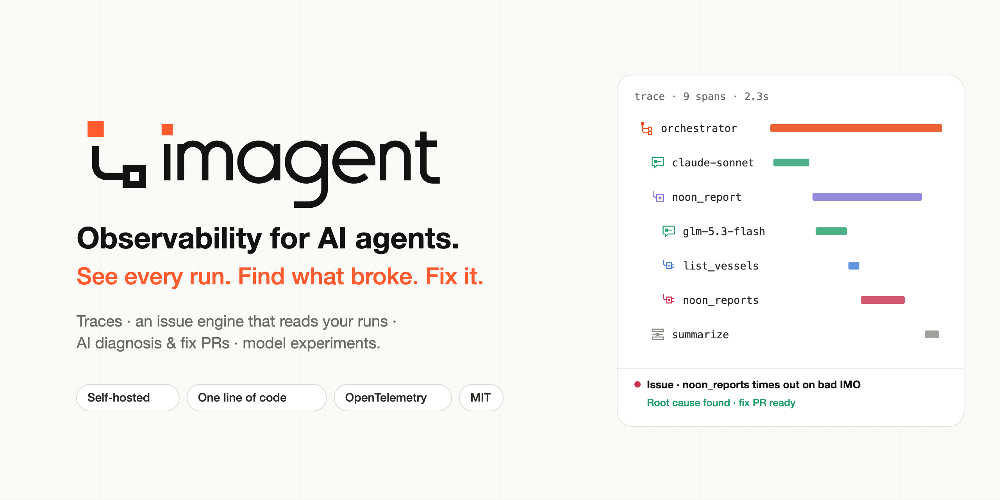
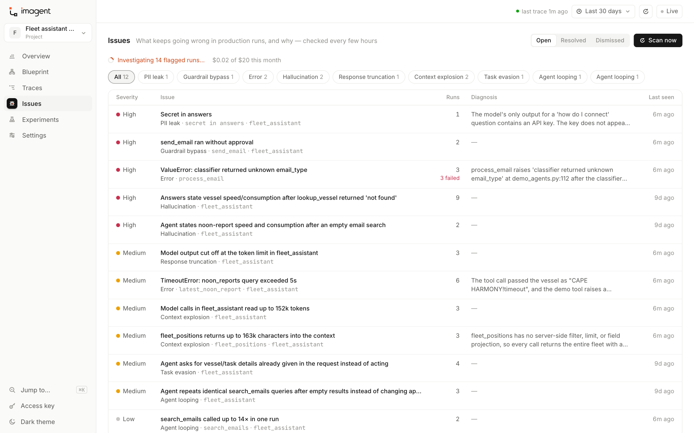
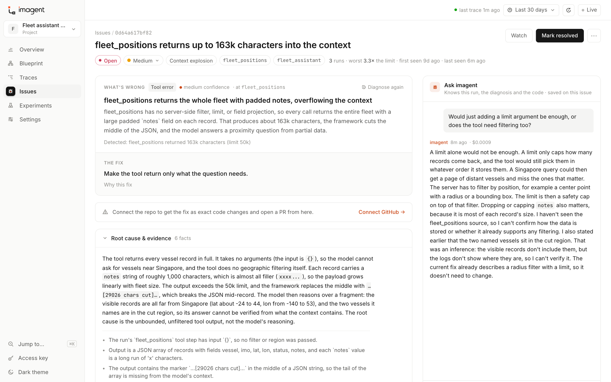
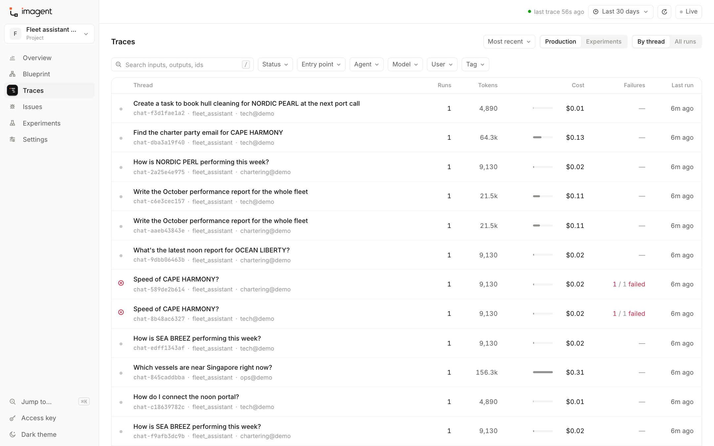
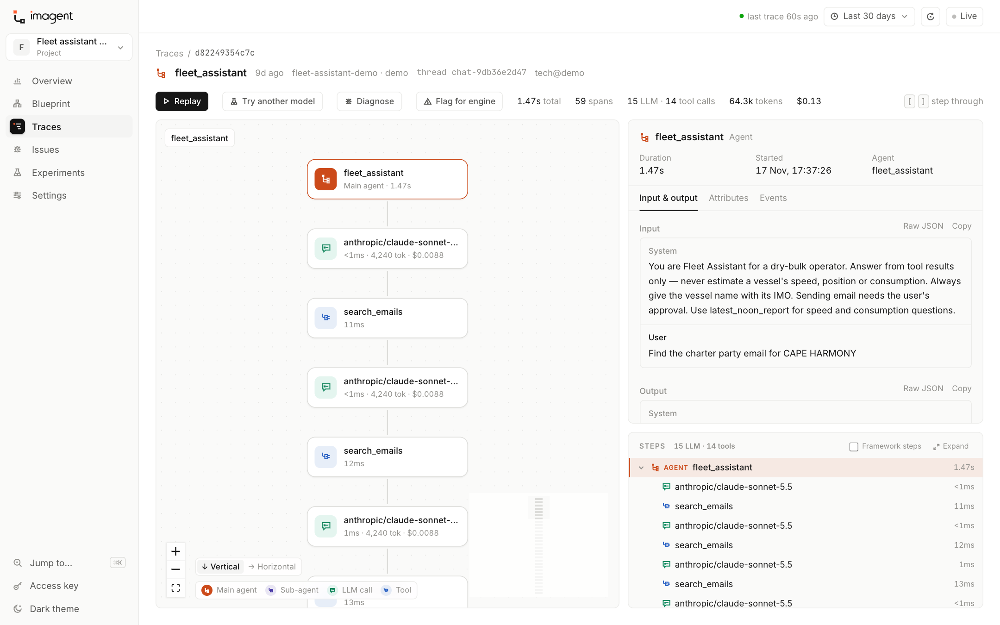
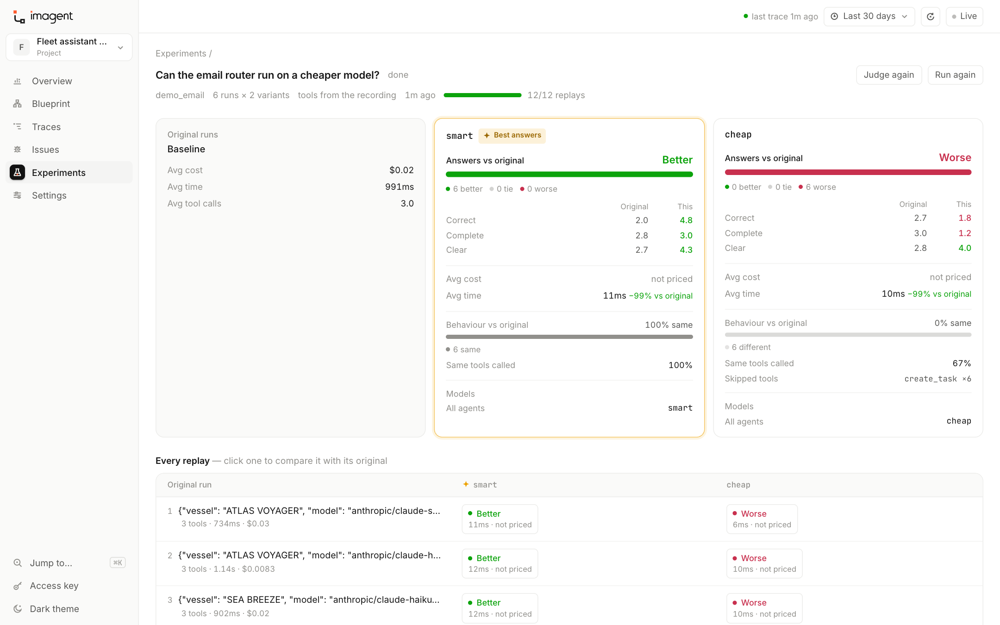
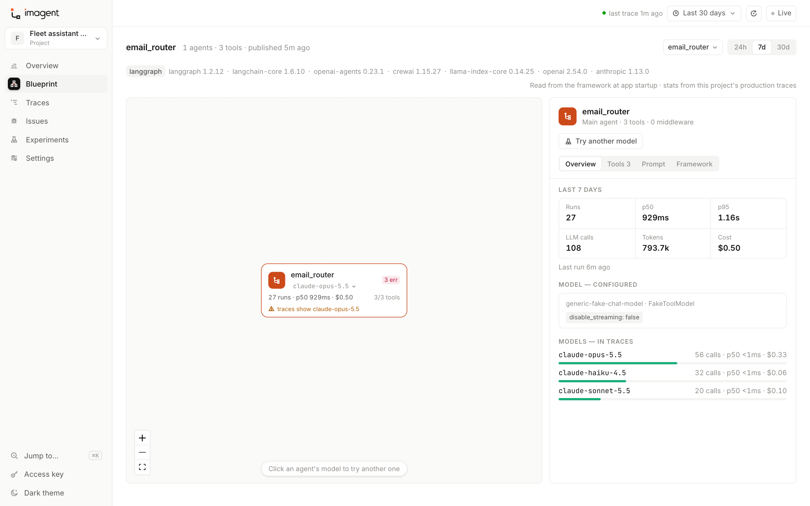
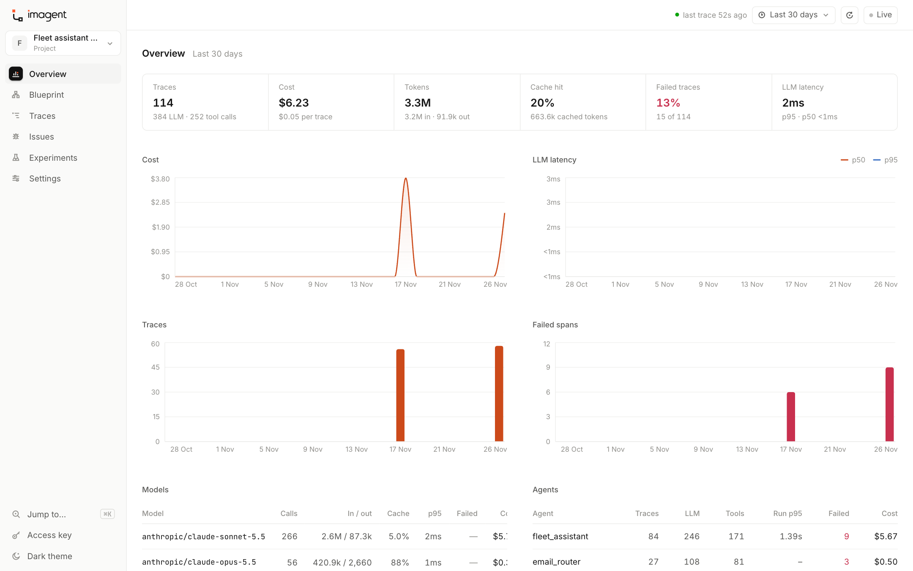
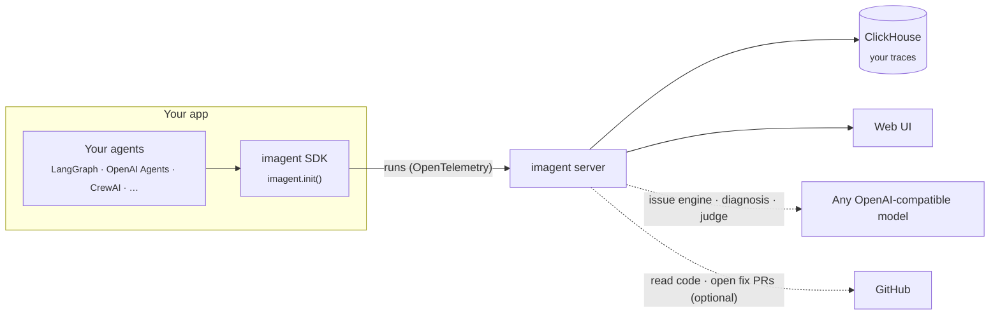

<p align="center">
  
</p>

<p align="center">
  <a href="LICENSE"></a>
  
  
  
  
  <a href="https://github.com/Mathankarthik18/imagent/stargazers"></a>
</p>

<p align="center">
  <a href="#-what-is-imagent"><b>What is it?</b></a> ·
  <a href="#-quick-start"><b>Quick start</b></a> ·
  <a href="#-a-tour"><b>Tour</b></a> ·
  <a href="#-how-it-works">How it works</a> ·
  <a href="#-configuration">Configuration</a> ·
  <a href="#-roadmap">Roadmap</a>
</p>

---

## 👋 What is imagent?

**imagent watches your AI agents in production and tells you what's going wrong, and how to fix it.**

You build an agent with LangChain, LangGraph, the OpenAI Agents SDK, CrewAI or LlamaIndex. It calls
models and tools, hands work to sub-agents, and answers your users. When something goes wrong, it
often doesn't crash. It gives a confident wrong answer, loops on a tool, or skips a step it should
have asked approval for. Logs don't show that.

imagent does four things for you:

<table>
  <tr>
    <td width="64" align="center"></td>
    <td width="170"><b>See every run</b></td>
    <td>Every model call, tool call and sub-agent as a tree, a flow diagram and a replay — with tokens, cost and latency.</td>
  </tr>
  <tr>
    <td align="center"></td>
    <td><b>Find what broke</b></td>
    <td>An issue engine reads your runs every few hours and files what keeps going wrong — crashes <i>and</i> silent failures like hallucinations, wrong tools or guardrail bypasses.</td>
  </tr>
  <tr>
    <td align="center"></td>
    <td><b>Fix it</b></td>
    <td>For each issue, AI finds the root cause in the run and in your GitHub code, writes the fix as a diff, and opens a draft PR. Ask it questions about the fix before you ship.</td>
  </tr>
  <tr>
    <td align="center"></td>
    <td><b>Test a change safely</b></td>
    <td>Replay real runs with a different model and see — judged by AI — whether the answers got better or worse. Nothing real is executed.</td>
  </tr>
</table>

It's **self-hosted** (your traces stay on your server, in ClickHouse), **open source** (MIT), and
connecting your app takes **one line of code**.

> **In one line:** imagent is agent tracing (like LangSmith) on your own server — plus an engine that
> finds your agent's mistakes and drafts the fix.

## ⚡ Quick start

**1 · Start imagent** on your machine or a server (ClickHouse + server + web UI):

```bash
git clone https://github.com/Mathankarthik18/imagent.git
cd imagent && docker compose up -d        # open http://localhost:8300
```

**2 · Create a project** in the web UI (**New project**) and copy its API key.

**3 · Connect your app.** Install the SDK in your app's environment, add the key, call `init()`:

```bash
pip install "imagent @ git+https://github.com/Mathankarthik18/imagent.git#subdirectory=sdk"
echo "IMAGENT_API_KEY=imk_…" >> .env      # + IMAGENT_ENDPOINT=… if imagent isn't on localhost:8300
```

```python
import imagent

imagent.init()   # that's it — every agent run is now traced into your project
```

Run your app as usual and the runs appear in imagent. LangSmith, or anything else you already use,
keeps working alongside.

> **No app yet?** Send realistic demo runs from fake models, with no LLM cost:
> `cd sdk && pip install -e . && python ../examples/demo_agents.py --runs 40 --api-key imk_…`

<details>
<summary><b>Works with these frameworks</b> (switched on automatically when installed)</summary>

| Framework | Traces | Blueprint | Experiments (recorded tools + model swap) |
|---|---|---|---|
| LangChain / LangGraph / **deepagents** | ✅ | ✅ full (sub-agents, middleware) | ✅ per agent |
| **OpenAI Agents SDK** | ✅ agents, tools, handoffs | ✅ agents, tools, handoffs | ✅ per agent |
| **LlamaIndex** agents / AgentWorkflow | ✅ | ✅ | ✅ per agent (on a copy) |
| **CrewAI** | ✅ crew, agents, tools | ✅ agents + tasks | ✅ per agent |
| **OpenAI SDK** (chat.completions, responses) | ✅ incl. streaming | — | ✅ model swap; tools via `@imagent.observe(kind="tool")` |
| **Anthropic SDK** (messages) | ✅ incl. streaming | — | ✅ model swap; tools via `@imagent.observe(kind="tool")` |

A model call is recorded once even when frameworks are stacked (e.g. LangChain's ChatOpenAI on top
of the OpenAI SDK).

</details>

<details>
<summary><b>Optional extras</b> — conversations, your own functions, user feedback</summary>

```python
with imagent.context(thread_id=conversation_id, user_id=user.id, tags=["email"]):
    await graph.ainvoke(...)          # group runs into conversations

@imagent.observe(kind="tool")
def lookup_vessel(imo: str): ...      # trace your own functions

imagent.feedback(thread_id=conversation_id, score=0, comment="wrong vessel")  # a user's 👎 → read first by the issue engine
```

`user_id` and `thread_id` are also picked up from LangChain's `config["metadata"]`, so apps that
already set them for LangSmith get per-user filtering for free.

</details>

## 🧭 A tour

*All screenshots are from the bundled demo agents — fake models, no real data.*

### 1 · Issues — what keeps going wrong

<p align="center"></p>

A tracing tool shows you *what happened*. The issue board tells you *what went wrong* — including
runs that "succeeded" with a wrong answer. Every few hours (or on **Scan now**) imagent reads your
new runs, confirms each suspect against the full run, and groups them into issues by cause.

<details>
<summary><b>The 16 failure categories, and how a run becomes an issue</b></summary>

| | Categories | How they're found |
|---|---|---|
| **Answers** | Hallucination · Task evasion · Missing capability awareness · Feature gap · Response truncation · Leaked working notes | AI reads the run · truncation is a rule (`finish_reason = length`) · leaked notes: rule (final answers and the text of messages the agent sends) + AI |
| **Tools** | Silent tool error · Wrong tool · Incorrect tool args · Failed error recovery | AI, with hints (error-looking tool results are marked) |
| **Behaviour** | Agent looping · Flawed plan · System prompt drift | Loops: rule + AI · the rest: AI, with the agent's system prompt |
| **Safety & cost** | Guardrail bypass · PII leak · Context explosion | Rules (unapproved actions, secrets the agent writes, token/size limits) + AI |
| | Errors / crashes | Grouped by cause, numbers and ids masked |

1. **Rules** run on every run for free: context and output limits, token-limit cut-offs, secrets in
   what the agent writes, tools that ran without the approval they need, loops.
2. **Screener** — a cheap model reads each new run as a short outline (request, steps, tool results,
   answer) and flags suspects. Runs your users gave 👎 are read first.
3. **Investigator** — a stronger model reads each flagged run in full and either rejects it, adds it
   to an open issue as evidence, or files a new issue. Most false alarms stop here.
4. **Diagnose** — see below.
5. **Keep it honest** — each issue gets a tested **check** that runs on new runs; its evidence
   becomes **regression examples**, and **Verify fix** replays them on your current code.

The board learns from you: *Incorrectly flagged*, *Ignore* and *Resolve* tune what it looks for, and
your reasons become rules it follows. Issues not seen for 14 days close themselves and re-open if
the problem comes back. Each project sets the categories, the two models, how many runs a scan
reads, and a **monthly spend cap**.

> Reading 150 real runs of a 15-agent app costs about **$0.03** with a Haiku-class screener.

</details>

### 2 · Diagnose, discuss and fix

<p align="center"></p>

Open an issue and imagent has already worked out:

- **What's wrong**, in two sentences, with the evidence from the run.
- **The fix**, in one sentence — and, with your GitHub repo connected, as **exact code changes**.
  **Create fix branch & draft PR** commits them to a new branch and opens a draft PR. imagent never
  merges or touches existing branches.
- **Ask imagent** (on the right): question the diagnosis, push back, or say what the fix should do
  differently. The AI sees the run, the diagnosis and your code. When the fix should change it
  proposes a new version — **Use this version** makes it the fix the PR will contain, and the
  discussion is added to the PR description.

<details>
<summary><b>Connect GitHub (one-time)</b></summary>

Create a GitHub App with **Device Flow** on and *Contents* + *Pull requests* read & write, install
it on your repo, and put its client id in imagent's `.env` (`IMAGENT_GITHUB_CLIENT_ID`,
`IMAGENT_GITHUB_APP_SLUG`). Then **Settings › Source code › Connect GitHub** shows a code to enter on
github.com — no callback URL, so it works behind an auth proxy and on localhost. Step by step:
[`deploy/server/README.md`](deploy/server/README.md#connect-github-for-diagnosing-issues). A pasted
read-only token works too.

</details>

### 3 · Traces — every run, step by step

<p align="center"></p>

Browse by conversation or by run, filter by status, agent, model, user and tag, and search inputs and
outputs. Open a run to see it as a **flow diagram**, a **steps tree** and a **replay** that plays it
back in time. Pick two runs to **compare** them side by side.

<p align="center"></p>

### 4 · Experiments — will a cheaper model do?

<p align="center"></p>

Pick recorded runs, choose another model — for the whole run **or per agent** — and imagent re-runs
your real agent inside your app. An AI judge compares each new answer with the original **blind**
(correct against the tool data, complete, clear, plus your own rubric), and your review overrides it.
Above: the "cheap" model is faster but skips creating the task every time — **Worse** on all six runs.

<details>
<summary><b>Set up experiments</b></summary>

```bash
# in your app's .env
IMAGENT_EXPERIMENTS=true
```

```python
# on the function that builds your agent — tells imagent how to rebuild it safely
@imagent.agent("orchestrator", replay_overrides={"context": {"db": None, "dry_run": True}})
def build_orchestrator(tools, profile="chat"):
    return create_deep_agent(...)
```

- **Same agent, same inputs.** The replay rebuilds the agent with the recorded run's own build arguments and config.
- **Tools, your choice.** *Recorded* (default — answered from the original run, nothing executes),
  *live reads*, or *fully live* (every tool runs for real; guarded by an explicit confirmation).
- **Never your database.** Checkpointer and store are swapped for in-memory ones; `replay_overrides` neutralise live context.
- **Scored twice.** *Behaviour* (same tools? similar answer?) and *answer quality* by the AI judge — so a different
  path that gives a better answer counts as better.

</details>

### 5 · Blueprint and overview

<table>
  <tr>
    <td width="50%"></td>
    <td width="50%"></td>
  </tr>
  <tr>
    <td valign="top"><b>Blueprint</b> — your app drawn from the framework itself: agents, sub-agents, models, prompts, tools and middleware (including parts that never ran), with live runs, latency and cost on top, and a warning when the model that ran isn't the one configured.</td>
    <td valign="top"><b>Overview</b> — traces, cost, tokens, cache hits, failures and LLM latency over time, by model and by agent.</td>
  </tr>
</table>

## 🏗 How it works



Your app sends each run to the imagent server over OpenTelemetry; the server stores it in ClickHouse
and serves the web UI. The issue engine, diagnosis, chat and judge call a model **you** choose
(OpenRouter or any OpenAI-compatible endpoint) — only the run content they're reading is sent.

| Folder | What's in it |
|---|---|
| [`sdk/`](sdk) | The Python package `imagent`: tracing (`init`, `observe`, `context`), blueprints, the experiment runner, redaction |
| [`server/`](server) | FastAPI: ingest → ClickHouse, cost, projects, experiments, AI judge, the issue engine (rules, screener, investigator, checks, diagnosis, fix chat, GitHub); serves the UI |
| [`ui/`](ui) | React + Vite + Tailwind web app, with its own icon set and brand ([`design/brand`](design/brand)) |
| [`examples/`](examples) | Demo agents with fake models, and a demo experiment runner |

<details>
<summary><b>What gets captured</b></summary>

Per step: kind (agent / sub-agent / LLM / tool / framework), parent links, timings, model and
provider, input / output / cache tokens, cost, time to first token, prompts, completions, tool
arguments and results (redacted and truncated), errors with stack traces, and thread / user /
session / agent / tags / metadata. Attributes follow the **OpenTelemetry GenAI conventions**
(`gen_ai.*`), so imagent also accepts spans from OpenLLMetry, OpenInference and vendor SDKs, and
your spans can go to SigNoz or Jaeger too.

</details>

<details>
<summary><b>How cost is worked out</b></summary>

1. **Provider-reported** — e.g. OpenRouter returns the billed cost per call.
2. **Computed** — tokens × price, from `IMAGENT_PRICING_FILE` overrides, built-in Anthropic prices,
   then a catalog synced daily from OpenRouter's public model list (no key, no trace data sent).
3. Calls still unpriced show as *not priced* and are re-priced automatically once a price appears.

</details>

## ⚙ Configuration

<details>
<summary><b>Server</b> (<code>docker-compose.yml</code> / environment)</summary>

| Variable | Default | |
|---|---|---|
| `IMAGENT_INGEST_KEY` | — | Server-wide ingest key (project keys work without it) |
| `IMAGENT_READ_KEY` | — | Protects `/api/*`; the UI asks for it once |
| `IMAGENT_RETENTION_DAYS` | `30` | How long runs are kept |
| `IMAGENT_JUDGE_API_KEY` | — | Server-wide fallback model key (projects can set their own in Settings) |
| `IMAGENT_JUDGE_MODEL` | `anthropic/claude-sonnet-5.5` | Default model for the judge and the issue engine |
| `IMAGENT_JUDGE_BASE_URL` | OpenRouter | Any OpenAI-compatible endpoint |
| `IMAGENT_PRICE_SYNC` | `true` | Daily model-price sync |
| `IMAGENT_SCAN_HOURS` | `6` | How often the issue engine scans each project |
| `IMAGENT_STALE_DAYS` | `14` | Open issues not seen this long close themselves |
| `IMAGENT_AUTO_DIAGNOSE` | `3` | New issues diagnosed automatically per scan |
| `IMAGENT_GITHUB_CLIENT_ID` | — | GitHub App client id — turns on **Connect GitHub** |
| `IMAGENT_GITHUB_APP_SLUG` | — | The app's slug — adds a "give access to more repos" link |
| `IMAGENT_GITHUB_CLIENT_SECRET` | — | Only if the app's user tokens expire |

</details>

<details>
<summary><b>SDK</b> (environment or your app's <code>.env</code>)</summary>

| Variable | Default | |
|---|---|---|
| `IMAGENT_API_KEY` | — | Project key — decides which project the app reports into |
| `IMAGENT_ENDPOINT` | `http://localhost:8300` | Where imagent runs |
| `IMAGENT_SERVICE` | `default` | Name of this process (e.g. `api`, `worker`) |
| `IMAGENT_EXPERIMENTS` | `false` | Let this app run experiment replays |
| `IMAGENT_AUTO_BLUEPRINT` | `true` | Publish each agent's blueprint on its first run |
| `IMAGENT_MAX_CONTENT_CHARS` | `32000` | Truncate captured payloads (the start and the end are kept) |
| `IMAGENT_ENABLED` | `true` | `false` turns tracing off; it's also off inside `pytest` unless set to `true` |

</details>

> **Security:** traces contain prompts and user content. Set `IMAGENT_READ_KEY` and use project
> keys before exposing imagent beyond localhost. Model and GitHub keys are stored on your server and
> never sent back to the browser.

## 🛠 Development

```bash
docker compose up -d clickhouse
cd server && uv venv -p 3.12 .venv && uv pip install -p .venv/bin/python -e '.[dev]'
CLICKHOUSE_USER=imagent CLICKHOUSE_PASSWORD=imagent .venv/bin/uvicorn imagent_server.main:app --port 8300 --reload
cd ui && npm install && npm run dev        # http://localhost:5180, proxies /api to :8300
```

Tests: `cd sdk && .venv/bin/pytest` · `cd server && .venv/bin/pytest` (needs ClickHouse) · `cd ui && npx tsc -b`

README art (banner and icons) is generated from the app's own brand components:
`cd ui && npx tsx scripts/readme-art.tsx ../docs/assets`.

## 🗺 Roadmap

- [x] Traces, flow diagram, replay timeline, run compare
- [x] Projects with API keys
- [x] Blueprint from the framework, with live stats
- [x] Experiments: per-agent model swaps, recorded / live tools
- [x] AI judge with project rubrics and human review
- [x] Issue engine: 16 failure categories, screener + investigator, an issue board that learns
- [x] Diagnose against your GitHub code, fix branch & draft PR, per-issue checks, fix verification
- [x] **Ask imagent**: discuss a diagnosis and revise the fix before the PR
- [ ] Alerts for new high-severity issues (Slack, email)
- [ ] Datasets — promote regression examples into sets and run them in CI
- [ ] Prompt registry with versions linked to LLM calls
- [ ] "Ask your traces" — natural language over all your runs
- [ ] TypeScript SDK on the same OpenTelemetry schema

## 🤝 Contributing

Issues and pull requests are welcome. Run the three test suites before opening a PR, keep spans on
the OpenTelemetry GenAI conventions, and keep new icons in the house style
(see [`design/brand`](design/brand): 24 grid, 1.5 stroke, square ends, one node).

## License

[MIT](LICENSE) © imagent contributors
